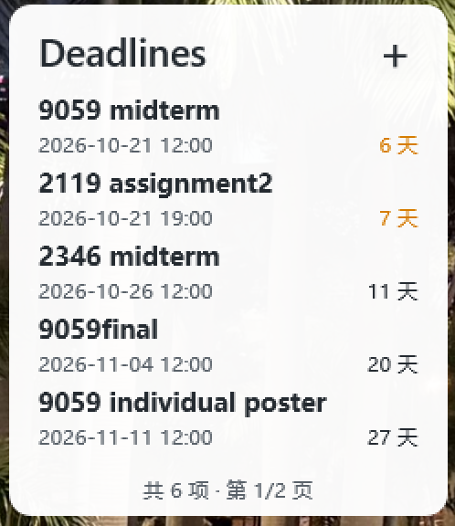

# Deadline Widget

[](https://github.com/pizza1107/deadline-widget)
[](https://github.com/pizza1107/deadline-widget/actions/workflows/ci.yml)

把课程作业、考试和其他截止日期放在 Windows 桌面上。小组件通过 Rainmeter 显示；点击右上角的“＋”，就能打开管理窗口添加或修改任务。无需登录，任务保存在自己的电脑上。



## 下载与安装

适用于 64 位 Windows 10 或 Windows 11。需要先安装 [Rainmeter 4.5 或更新版本](https://www.rainmeter.net/)；不需要单独安装 .NET。

1. 从本项目的 [Releases 页面](https://github.com/pizza1107/deadline-widget/releases)下载名称含 `win-x64.zip` 的完整压缩包。
2. 将 ZIP **全部解压**到一个文件夹，保留其中的 `Manager` 文件夹、`.rmskin` 和两个 `.ps1` 文件。不要只下载或双击 `.rmskin`：它仅安装皮肤和桥接插件，不会安装管理器。
3. 在文件资源管理器中打开解压后的文件夹，在地址栏输入 `powershell` 并按回车，然后运行：

   ```powershell
   .\Install-V2.ps1
   ```

4. Rainmeter 弹出皮肤安装确认时，点击安装。桌面出现 **Deadlines** 卡片后，点击“＋”开始添加任务。

安装完成后会立即启动后台管理器，并为当前 Windows 用户创建开机启动项。即使以后管理器退出，点击小组件的“＋”也会尝试重新启动它。若希望每次开机都看到小组件，也请在 Rainmeter 设置中开启随 Windows 启动。

## 日常使用

- 点击小组件右上角的“＋”，打开“截止日期管理”窗口。
- 在窗口中点击“＋ 添加”，输入标题、日期和小时；分钟可以留空，默认为 `00`。点击“保存”。
- 在“进行中”列表里可以编辑、标记完成或删除；在“已完成”列表里可以恢复或删除。
- 小组件每页显示最多五条任务。任务更多时，将鼠标放在小组件上滚动翻页。
- 距截止时间不超过 **10 天**时显示黄色，不超过 **3 天**时显示红色；过期任务显示为过期状态。


## 升级与卸载

升级时下载新版完整 ZIP，解压后再次运行其中的 `Install-V2.ps1`。已有任务会保留。升级前，请在任务管理器中结束 `DeadlineWidget.Manager` 进程；如果它仍在运行，安装器会明确报错并停止，以免旧版管理器继续占用文件。

如果你已安装 v0.1.0，修复版发布后也要下载**新版完整 ZIP**并重新运行 `Install-V2.ps1`；只替换 `.rmskin` 无法补齐管理器和启动项。安装脚本会核对任务文件和备份未被修改。

卸载时，在解压后的文件夹运行：

```powershell
.\Uninstall-V2.ps1
```

默认卸载会移除小组件和管理器，**保留任务数据**。如果确定连任务和备份也要删除，再运行 `Uninstall-V2.ps1 -RemoveUserData`。如果已经删除下载文件夹，可重新下载完整 ZIP 取得卸载脚本。

## 遇到问题

- **桌面没有出现卡片：** 打开 Rainmeter 管理器，在皮肤列表中展开 `DeadlineWidgetV2`，选中 `DeadlineWidgetV2.ini`，点击“加载”。
- **点击“＋”没有打开管理窗口，或底部显示“管理器不可用”：** 确认下载的是完整 `win-x64.zip`，并在解压目录重新运行 `Install-V2.ps1`。安装过程若报错，请不要将其当作安装成功。默认安装应有 `%LOCALAPPDATA%\DeadlineWidgetV2\Manager\DeadlineWidget.Manager.exe`、`%APPDATA%\Rainmeter\Plugins\DeadlineWidgetBridge.root` 和当前用户“启动”文件夹中的 `DeadlineWidgetV2 Manager.lnk`。可查看 `%LOCALAPPDATA%\DeadlineWidgetV2\logs\bridge.log`：`status=3` 表示没有找到管理器或其目录；`status=4` 表示启动失败，后面的 `error=` 是 Windows 错误码。若仍无效，请在 [Issues](https://github.com/pizza1107/deadline-widget/issues) 中说明 Windows、Rainmeter 版本和错误码，不要上传含个人路径的完整日志。
- **PowerShell 提示“禁止运行脚本”或出现 `PSSecurityException`：** 这是部分 Windows 电脑的默认执行策略导致的。确认 ZIP 来自本项目的 Releases 页面后，在解压目录依次运行：

  ```powershell
  Set-ExecutionPolicy -Scope Process -ExecutionPolicy RemoteSigned
  Unblock-File .\Install-V2.ps1
  .\Install-V2.ps1
  ```

  `Process` 只对当前 PowerShell 窗口生效，关闭窗口后失效，不会永久修改电脑设置。如果仍然被禁止，请运行 `Get-ExecutionPolicy -List`；公司或学校管理的电脑可能受到组策略限制，需要联系管理员。

## 数据与隐私

任务保存在 `%LOCALAPPDATA%\DeadlineWidgetV2\deadlines.json`，同目录保存最近一份备份。程序没有账号、云同步或遥测功能。反馈问题时，请不要上传自己的任务数据或包含个人路径的日志。

目前只支持 Windows x64；不提供系统通知，也不能从课程表或日历自动导入任务。

## 开发与许可

项目由 C# 管理器、Rainmeter 皮肤和原生桥接组件组成。从源码构建、运行测试或参与开发，请看 [CONTRIBUTING.md](https://github.com/pizza1107/deadline-widget/blob/master/CONTRIBUTING.md)。项目采用 [MIT License](https://github.com/pizza1107/deadline-widget/blob/master/LICENSE)。
